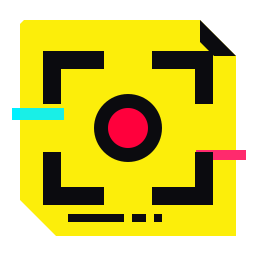
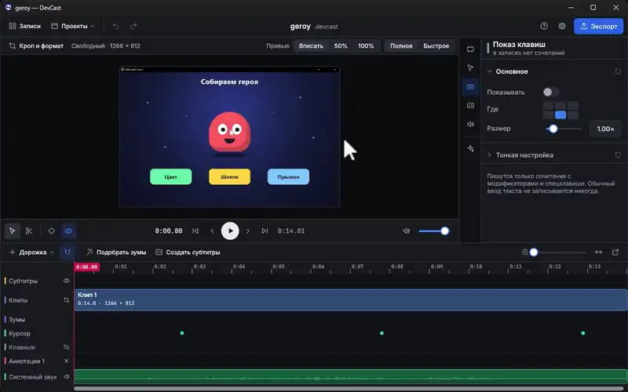
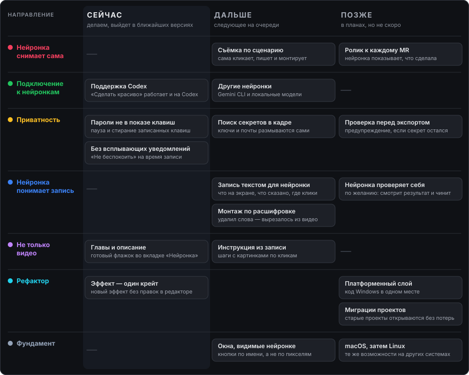

<div align="center">



# DevCast

**Запись экрана и монтаж видео-уроков для Windows.**
Записал — подрезал паузы — зумы встали сами — субтитры за минуту — готово.

[](../../releases/latest)
[](LICENSE)




<sub>Зумы и субтитры — по одной кнопке. Снято и смонтировано в самом DevCast.</sub>

</div>

## Установка

Нажмите «Скачать» выше, запустите `DevCast-Setup.exe` и выберите папку. Права администратора не нужны.

Если Windows SmartScreen предупредит: «Подробнее» → «Выполнить в любом случае». Установщик пока без цифровой подписи.

## Что умеет

| | |
|---|---|
| 🔍 **Автозумы по кликам** | Ставятся сразу после записи. Камера идёт за курсором, курсор сглаживается, клик подсвечивается. |
| 💬 **Субтитры на компьютере** | Речь распознаёт Whisper, звук никуда не отправляется. Русский язык, подсветка произносимого слова. |
| ✂️ **Монтаж без рутины** | «Убрать паузы» одной кнопкой, вырезание по словам из расшифровки, скорость, несколько клипов. |
| ✨ **Нейронка монтирует сама** | «Сделать красиво»: Claude Code или Codex убирает паузы и оговорки и ставит зумы. Отменяется одним шагом. |
| 🎥 **Запись** | Экран, окно или область, до 120 кадров в секунду. Системный звук и микрофон на отдельных дорожках. |
| ✏️ **Аннотации** | Текст, фигуры, картинки, рисование, размытие лишнего, показ нажатых клавиш, кейфреймы. |
| 🔊 **Звук** | Нормализация по EBU R128, шумоподавление микрофона, фоновая музыка. |
| 📤 **Экспорт** | MP4 до 4K на видеокарте или процессоре и GIF. Идёт в фоне, можно работать дальше. |

## Командная строка для нейронок

Всё, что умеет окно, умеет и команда `devcast`. Её можно отдать своей нейронке, чтобы монтировать в чате или обрабатывать проекты пачкой.

```
devcast record --source screen:1 --duration 10 -o урок.devcast
devcast zoom add --at clicks
devcast captions gen
devcast export -o урок.mp4
```

## Куда идём

<a href="docs/roadmap/next.md"></a>

**Сейчас** — уже делаем. **Дальше** — следующее на очереди. **Позже** — в планах, но не скоро. Дат нет. Подробно о каждом пункте — [docs/roadmap/next.md](docs/roadmap/next.md).

## Известные проблемы

- Вырез слова иногда задевает край соседнего слова на 0,05–0,1 с.
- Пока открыт редактор, правки из командной строки и нейронки доходят до окна с задержкой около 0,1 с.
- Если вырезать слово после создания субтитров, в реплике остаётся его текст: создайте субтитры заново.

Нашли ошибку или есть идея — [заведите задачу](../../issues/new/choose).

## Участие и лицензия

Код пишут нейронки под присмотром людей, качество держат тесты и проверки. Как предложить изменение — [CONTRIBUTING.md](CONTRIBUTING.md), устройство проекта — [docs/](docs/ROADMAP.md), изменения по версиям — [CHANGELOG.md](CHANGELOG.md).

Лицензия [AGPL-3.0-or-later](LICENSE). Вместе с программой ставятся FFmpeg (GPL v3), Vulkan Runtime и шрифты под своими лицензиями: `xtask/package/THIRD-PARTY-NOTICES.txt`.
