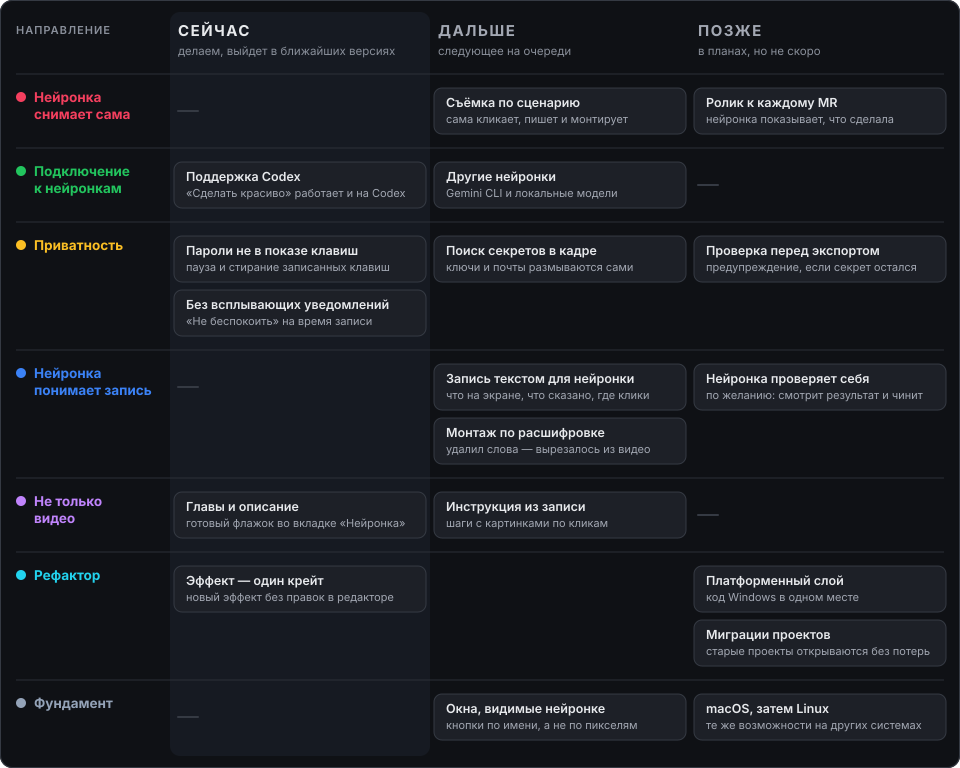

# Куда идём после выпуска

Направления развития DevCast после этапа 8. Это не этап с номерами задач, а доска «сейчас — дальше — позже» по семи направлениям. Пункт становится задачей в файле этапа, когда до него доходит очередь.

**Сейчас** — уже делаем, выйдет в ближайших версиях. **Дальше** — следующее на очереди. **Позже** — в планах, но не скоро. Дат нет: пункт переезжает влево, когда до него доходят руки.

Имена новых команд (`devcast digest`, `devcast demo` и другие) — рабочие, таких команд пока нет.

## Нейронка снимает сама

Нейронка, которая пишет код, сама запускает программу, снимает ролик и монтирует его. Запись нужного окна на заданное время одной командой уже есть: `devcast record --source … --duration …`.

- **Сценарий съёмки** (дальше). `devcast demo run сценарий.yaml`: шаги «открой, нажми, набери, подожди». DevCast сам ведёт мышь, пишет и монтирует. Запись, автозумы и рецепты готовы, управление вводом — новое.
- **Видео к каждому MR** (позже). После задачи нейронка запускает сценарий и прикладывает ролик и раскадровку к MR. Ролик собирает DevCast, а не нейронка: так его сложнее подделать. Нужен «Сценарий съёмки».

## Подключение к нейронкам

Вход в DevCast для любой нейронки дешёвый, одинаковый и без ловушек. Путь один — командная строка: MCP не делаем (SCOPE).

- **Поддержка Codex** (сейчас). «Сделать красиво» запускается и на Codex, но его флаги и песочница не проверены. Проверить вживую и закрепить тестами.
- **Другие нейронки** (дальше). Gemini CLI и локальная модель через Ollama: тот же бриф и та же песочница, что у Claude Code и Codex.

## Приватность

Ролик не должен выдать пароль, ключ или чужую почту, даже если автор не заметил.

- **Клавиши без паролей** (сейчас). Пишутся все клавиши, текст тоже (решение 009). Нужны пауза записи клавиш горячей клавишей и команда «стереть клавиши с … по …».
- **Тишина уведомлений** (сейчас). На время записи включается режим «Не беспокоить» Windows, после стопа возвращается как было.
- **Поиск секретов в кадре** (дальше). `devcast redact --find`: текст с экрана проверяется по шаблонам (ключи, токены, почты, свои слова) и закрывается размытием на время показа. Размытие есть, чтение текста с экрана берётся из «Дайджеста».
- **Проверка перед экспортом** (позже). Диалог экспорта показывает «в кадре найдены: почта (2), ключ (1)» со ссылкой на место.

## Нейронка понимает запись

Нейронка знает, что происходит в записи, и монтирует по смыслу.

- **Дайджест для нейронки** (дальше). `devcast digest`: запись по сценам одним текстом — что на экране, что сказано, куда кликали, один кадр на сцену. `transcript`, `events` и `sheet` есть, чтение текста с экрана — новое.
- **Монтаж по тексту** (дальше). Панель расшифровки в редакторе: выделил слова, нажал Delete — кусок вырезан. Вырез по словам `cut w…` уже есть в CLI.
- **Нейронка проверяет себя** (позже). Необязательный флажок, по умолчанию выключен: после монтажа нейронка смотрит раскадровку результата по списку проверок и чинит найденное тем же шагом отмены. Выключен потому, что кадры стоят токенов (решение 2026-11-04: как можно меньше токенов).

## Не только видео

Одна запись даёт несколько результатов.

- **Инструкция из записи** (дальше). `devcast guide`: шаг на каждый клик, кадр с подсветкой места, подпись пишет нейронка по дайджесту. На выходе Markdown с картинками.
- **Главы и описание** (сейчас). Готовый флажок во вкладке «Нейронка» рядом с «Убрать паузы»: по расшифровке нейронка даёт название, описание и главы с временем. Сегодня это можно попросить словами, флажок избавляет от набора.

## Рефактор

Эффект должен быть одним крейтом и строкой регистрации. Сейчас новый эффект с панелью и дорожкой трогает 20–28 файлов в 4–6 крейтах (аудит 2026-11-10, раздел «Архитектура»).

- **Эффект — один крейт: таблицы** (сейчас). Вкладки инспектора, панели объектов и строки таймлайна уже таблицы (`inspector::TABS`, `object::OBJECTS`, `timeline/row.rs`). Осталось: жест на превью (`stage::Drag`) и поля `Evaluator` — им нужен общий шов «эффект рисует кадр» в `dc-core`/`dc-render`.
- **Эффект — один крейт: перевод эффектов** (сейчас). Крейты `fx/*` по одному переводятся на таблицы; проверка `seams` начинает смотреть и файлы регистрации.
- **Платформенный слой** (позже). Захват, папки, корзина и окна — за одним фасадом. Сейчас код Windows вызывается из 16 файлов программы и CLI. Первая задача этапа 9.
- **Миграции проекта** (позже). Миграции схемы и фикстура «проект прошлого выпуска открывается без потерь».

## Фундамент

- **Окна, видимые нейронке** (дальше). AccessKit в редакторе и настройках: нейронка находит кнопки по имени, а не по пикселям. Тот же механизм нужен «Сценарию съёмки».
- **macOS** (позже). Этап 9, [09-macos.md](09-macos.md).
- **Linux** (позже). Этап 10, [10-linux.md](10-linux.md).
